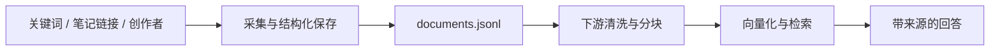
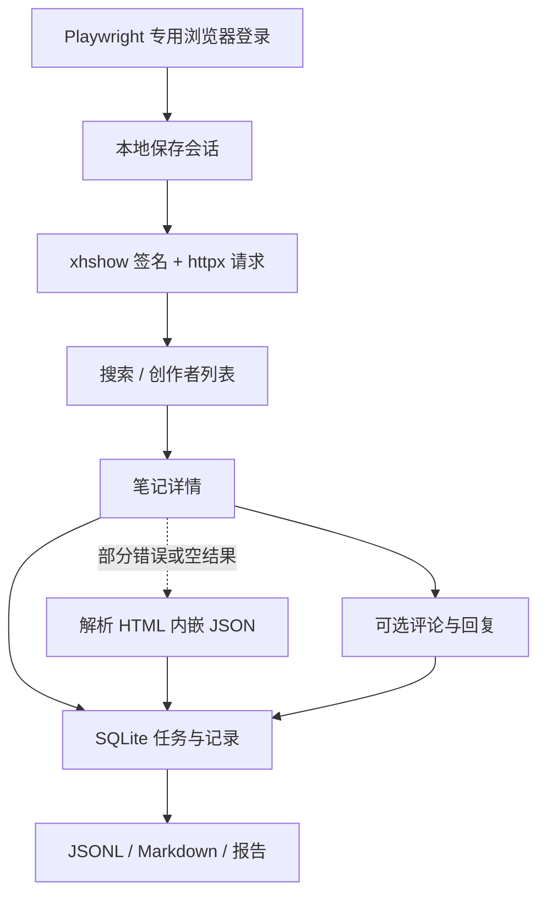

<div align="center">

# 🕷️ XHS Collector

### 小红书资料采集 · Codex Skill · RAG 数据准备

**从关键词到笔记与评论，让采集结果成为可追溯的本地资料。**

[](pyproject.toml)
[](skills/xhs-collector/SKILL.md)
[](#data)
[](LICENSE)

[快速开始](#quick-start) · [安装 Skill](#codex-skill) · [采集示例](#usage) · [数据与 RAG](#data) · [运作流程](docs/workflow.md) · [常见问题](#faq)

</div>

---

> **当前状态**：本地测试、浏览器启动、离线流程和 10 篇真实笔记采集已验证。图片下载与验证范围查看[验证记录](VALIDATION.md)；demo 仍使用合成样本。

## 📖 项目简介

XHS Collector 是一个面向学习、资料整理和 RAG 数据准备的**独立小红书采集工具**。输入关键词、笔记链接或创作者主页，即可按指定范围采集内容，保存为 JSONL 和 Markdown，并在中断后继续任务。

项目同时提供 **Python 命令行工具**与 **Codex Skill**：你可以自己运行命令，也可以让 Codex 按自然语言要求完成采集、查看进度和读取资料。

小红书接口适配参考 [MediaCrawler](https://github.com/NanmiCoder/MediaCrawler)，采集器、任务队列、存储与导出均在本项目中独立运行。

## ✨ 功能特性

| 能力 | 支持情况 | 说明 |
| :--- | :---: | :--- |
| 🔎 关键词搜索 | ✅ | 支持多个关键词，按总笔记数限制采集范围 |
| 📄 指定笔记 | ✅ | 从完整笔记链接获取详情 |
| 👤 创作者笔记 | ✅ | 按游标分页采集指定创作者的笔记 |
| 💬 评论与回复 | ✅ | 可选一级评论与二级回复，按每篇总量限制 |
| 🔑 登录态复用 | ✅ | 专用浏览器登录，本地保存会话 |
| ⏯️ 断点续跑 | ✅ | SQLite 持久化任务、分页位置和失败状态 |
| 📦 结构化导出 | ✅ | 笔记、评论、Markdown、RAG 文档与采集报告 |
| 🤖 Codex Skill | ✅ | 独立运行环境，支持自然语言触发 |

**当前范围**：文本与元数据采集，默认下载图片并保留原链接。图片 OCR、视频下载与转写、向量化及检索属于后续处理阶段。

<a id="quick-start"></a>

## 🚀 快速开始

### 1. 准备环境

| 依赖 | 要求 |
| :--- | :--- |
| Python | 3.11 或更高版本；当前已在 Windows / Python 3.12 验证 |
| 浏览器 | Windows 优先使用已安装的 Chrome / Edge，也可安装 Playwright Chromium |
| 登录 | 首次真实采集需在专用浏览器中完成小红书登录 |

下面的命令使用 **Windows PowerShell**，在项目根目录执行。

### 2. 安装依赖

```powershell
python -m venv .venv
.venv/Scripts/python -m pip install -e '.[dev]' -c requirements.lock
.venv/Scripts/python -m xhs_collector doctor --browser-check
```

<details>
<summary>🌐 没有可用浏览器，或使用 macOS / Linux？</summary>

安装 Playwright Chromium：

```powershell
.venv/Scripts/python -m playwright install chromium
```

macOS / Linux 将示例中的 `.venv/Scripts/python` 换为 `.venv/bin/python`。这些系统尚未完成本项目的实际运行验证。

登录时可通过 `--browser chrome`、`--browser msedge` 或 `--browser chromium` 指定浏览器。

</details>

### 3. 完成首次登录

```powershell
.venv/Scripts/python -m xhs_collector login --timeout 180
```

在弹出的专用浏览器中点击登录并扫码。返回 `authenticated` 后，会话已保存，浏览器会关闭。

```powershell
# 检查保存的登录态是否仍然有效
.venv/Scripts/python -m xhs_collector doctor --online
```

### 4. 开始第一次采集

```powershell
.venv/Scripts/python -m xhs_collector search `
  --keyword '露营装备' `
  --max-notes 10 `
  --run "$HOME/Documents/xhs-collector/runs/camping"
```

命令返回 JSON 摘要，`run` 字段给出实际保存位置。未指定 `--run` 时自动创建 `~/Documents/xhs-collector/runs/search-时间-随机标识/`，不会写入源码目录；也可用 `--run` 指定其他位置。优先查看 `report.json` 了解实际采集数量和任务状态。

<a id="codex-skill"></a>

## 🤖 安装到 Codex

需要 Python 3.11+ 和 Git。下载仓库后，在项目根目录执行安装器；安装 Skill 不需要先手动创建开发用 `.venv`：

```powershell
git clone https://github.com/nandalock/xhs-collector.git
cd xhs-collector
python scripts/install_skill.py
```

安装器会复制 skill、创建独立 Python 环境，并安装本项目的应用包。默认安装位置为 `~/.codex/skills/xhs-collector`；设置了 `CODEX_HOME` 时使用其下的 `skills` 目录。

安装器输出 `skill`、`launcher` 和 `runtime_python` 的实际路径。首次使用先检查浏览器并登录，默认安装路径下可这样执行：

```powershell
$launcher = Join-Path $HOME '.codex/skills/xhs-collector/scripts/run.py'
python "$launcher" doctor --browser-check
python "$launcher" login --timeout 180
python "$launcher" doctor --online
```

在专用浏览器中手动完成登录，返回 `authenticated` 才表示会话保存成功。设置了 `CODEX_HOME` 时，把 `$launcher` 换成安装器返回的路径。若没有 Chrome / Edge，使用安装器返回的 `runtime_python` 执行 `-m playwright install chromium`。

安装完成后，下一轮对话即可使用：

> 用 `$xhs-collector` 收集小红书上关于露营装备的 10 篇笔记，保存到本地供 RAG 使用。

> 用 `$xhs-collector` 查看上一次采集的进度，并读取其中 3 篇笔记。

首次真实采集仍需完成浏览器登录。Codex 会优先读取报告，再按需读取文档片段。

更新仓库后，同步更新安装后的 Skill：

```powershell
git pull
python scripts/install_skill.py --upgrade
```

也可以手动执行采集，返回 JSON 中的 `run` 是实际保存目录：

```powershell
$result = python "$launcher" search --keyword '电脑选购指南' --max-notes 10 | ConvertFrom-Json
$runDir = $result.run
python "$launcher" report --run "$runDir"
```

<details>
<summary>📂 安装方式与独立运行说明</summary>

- 安装的是普通应用包，源码目录移动后，已安装 skill 仍可运行。
- 运行时不需要 MediaCrawler 仓库。
- 同名 skill 已存在时，安装器默认拒绝覆盖；确认更新时使用 `--upgrade`。
- 虚拟环境依赖创建它的基础 Python，安装目录不应直接跨机器搬移。
- 如果当前会话还未发现新 skill，可提供安装器输出的 `SKILL.md` 路径。
- 手动调用时，使用已安装目录里的 `scripts/run.py`，后面接相同的 CLI 参数。

```powershell
# 默认安装路径；如自定义了 CODEX_HOME，请替换路径
python "$HOME/.codex/skills/xhs-collector/scripts/run.py" doctor
```

</details>

<a id="usage"></a>

## 🛠️ 采集与任务管理

### 关键词 + 评论

```powershell
.venv/Scripts/python -m xhs_collector search `
  --keyword '露营装备' `
  --max-notes 5 `
  --max-comments 20 `
  --sub-comments `
  --run "$HOME/Documents/xhs-collector/runs/camping-comments"
```

评论默认关闭。`--max-comments 20` 表示**每篇笔记的一级评论和回复合计最多 20 条**。重复传入 `--keyword` 可搜索多个关键词，笔记数量上限由所有关键词共享。

<details>
<summary>📄 采集指定笔记 / 创作者主页</summary>

链接必须是带 `xsec_token` 的完整网站链接。将下面占位内容替换为实际链接；目前不支持短分享链接。

```powershell
# 指定笔记；可重复传入 --url
.venv/Scripts/python -m xhs_collector detail `
  --url 'https://www.xiaohongshu.com/explore/笔记ID?xsec_token=实际参数&xsec_source=pc_search' `
  --run "$HOME/Documents/xhs-collector/runs/notes"

# 指定创作者
.venv/Scripts/python -m xhs_collector creator `
  --url 'https://www.xiaohongshu.com/user/profile/用户ID?xsec_token=实际参数&xsec_source=pc_search' `
  --max-notes 10 `
  --run "$HOME/Documents/xhs-collector/runs/creator"
```

</details>

### 续跑、报告与按需读取

```powershell
# 继续原任务：已保存记录按平台 ID 去重
.venv/Scripts/python -m xhs_collector resume --run "$HOME/Documents/xhs-collector/runs/camping"

# 查看采集摘要
.venv/Scripts/python -m xhs_collector report --run "$HOME/Documents/xhs-collector/runs/camping"

# 按文档 ID 读取正文片段
.venv/Scripts/python -m xhs_collector show `
  --run "$HOME/Documents/xhs-collector/runs/camping" --doc xhs:note:实际笔记ID --max-chars 3000

# 离线重建 JSONL、Markdown 和报告
.venv/Scripts/python -m xhs_collector export --run "$HOME/Documents/xhs-collector/runs/camping"
```

同一任务目录的来源与采集数量配置在创建后固定。更换关键词或调整采集规模时创建新目录；原任务中断后使用 `resume`。

<details>
<summary>⚙️ 数量限制、请求预算与失败重试</summary>

| 参数 | 默认值 | 含义 |
| :--- | :---: | :--- |
| `--max-notes` | `10` | 单个任务的笔记总量上限，可设 1–100 |
| `--max-comments` | `0` | 每篇评论总量上限，可设 0–100；0 表示关闭 |
| `--max-pages` | `5` | 每个来源的发现页数上限 |
| `--max-requests` | `100` | 每次执行的请求上限，包含重试和登录校验 |
| `--max-seconds` | `300` | 每次执行的时间预算，单位为秒 |
| `--delay` | `2` | 请求最小间隔，单位为秒；最小可设 1 |

```powershell
.venv/Scripts/python -m xhs_collector resume `
  --run "$HOME/Documents/xhs-collector/runs/camping" --max-requests 100 --max-seconds 300

# 解决失败原因后，显式重试失败项
.venv/Scripts/python -m xhs_collector resume --run "$HOME/Documents/xhs-collector/runs/camping" --retry-failed
```

普通网络错误和 5xx 最多尝试三次。401、403、429、平台访问限制或验证挑战会停止采集并保留队列；429 的 `Retry-After` 会记录到报告。工具不会自动处理验证码或轮换账号、IP。

</details>

<a id="data"></a>

## 📦 数据输出与 RAG 接入

每次采集都有自己的任务目录：

```text
~/Documents/xhs-collector/runs/camping/
├── run.json             # 任务配置
├── report.json          # 数量、失败分类、请求次数、续跑状态
├── notes.jsonl          # 标题、正文、标签、互动数、图片链接
├── comments.jsonl       # 评论正文、笔记 ID、父评论 ID
├── documents.jsonl      # 供下游 RAG 使用的统一文档
├── clean/               # 图文导出目录
│   ├── <笔记ID>.md
│   └── images/          # 与 Markdown 同级的图片文件夹
│       └── <笔记ID>-001.webp # 实际扩展名根据图片格式确定
├── snapshots/           # 剔除用户资料和访问凭据的详情 JSON
└── state.sqlite3        # 任务、游标与恢复信息
```

**接入 RAG 时优先读取 `documents.jsonl`：**

| 字段 | 用途 |
| :--- | :--- |
| `doc_id` / `note_id` | 唯一标识文档，关联原笔记 |
| `kind` | 区分笔记与评论 |
| `title` / `text` | 提供清洗、分块和向量化的文本 |
| `source_url` | 回答时引用来源 |
| `fetched_at` | 记录采集时间 |
| `content_hash` | 支持下游内容去重与变更比较 |
| `parent_comment_id` | 保留评论回复关系 |



采集器按平台 ID 去重，并为下游提供内容 hash。评论保留独立文档类型；图片文字需要 OCR，视频内容需要转写后才能进入文本检索流程。

`clean/` 中的 Markdown 包含标题、正文、图片和来源。图片保存在 `clean/images/`，Markdown 通过 `images/<笔记ID>-001.webp` 这样的相对路径引用；未下载成功的保留远程链接。复制整个 `clean/` 即可保留图文关系。使用 `--no-download-images` 只保存文字和远程链接。内容由 `src/xhs_collector/markdown.py` 的 `render_note_markdown()` 统一生成，调用时可用 `sections` 选择和排列标题、正文、图片、来源。

已有采集结果可补下图片，不会新增笔记，也不需要读取账号 Cookie：

```powershell
.venv/Scripts/python -m xhs_collector download-images --run '<已有任务的绝对路径>'
```

图片与接口请求共享请求数、时间和间隔预算；单张图片最多 20 MiB。图片错误页、类型不符或下载失败不会丢失笔记正文。普通失败处理后可用 `download-images --retry-failed` 重试，访问限制或限流则停止。`export` 仍只从本地状态重建文件，不发网络请求。

<details>
<summary>💾 检查点、导出一致性与本地凭据</summary>

SQLite 保存权威任务状态。任务结果和后续游标在同一事务中提交，异常时回滚当前任务；导出文件使用原子替换。中断后可能重新请求尚未提交的页面，已保存记录按 ID 幂等处理。

`snapshots/` 保存的是经过字段剔除的详情 JSON，不是原始 HTTP 字节归档。导出的来源 URL 去掉了访问 token，重新访问时可能需要获取新的完整链接。

`state.sqlite3` 含续跑所需的 `xsec_token`，应作为本地内部文件保留。浏览器状态与 `session.json` 含登录凭据，默认保存在：

| 系统 | 状态目录 |
| :--- | :--- |
| Windows | `%LOCALAPPDATA%/xhs-collector` |
| macOS / Linux | `~/.local/share/xhs-collector` |

可通过 `XHS_COLLECTOR_HOME` 指定其他位置。凭据文件不要提交到仓库或作为数据集分享。Linux/macOS 限制文件权限，Windows 继承当前用户目录 ACL。

</details>

## 🔧 技术原理



浏览器负责登录环境，批量采集通过网页接口完成。详情接口在部分错误或空结果下，尝试解析页面中的 `window.__INITIAL_STATE__`；访问限制不会触发这条备用路径。

## 🧪 开发与验证

```powershell
# 运行测试
.venv/Scripts/python -m pytest -q

# 不联网的合成数据演示：请选择尚未存在的任务目录
.venv/Scripts/python -m xhs_collector demo --run "$HOME/Documents/xhs-collector/runs/offline-demo"
```

离线演示使用真实签名库和合成 HTTP 响应，验证采集、分页、队列与导出。报告会标记 `data_origin: synthetic_fixture`。完整验证范围与真实平台验证进度见 [VALIDATION.md](VALIDATION.md)。

<details>
<summary>🗂️ 项目目录</summary>

```text
xhs-collector/
├── src/xhs_collector/
│   ├── cli.py           # 命令行入口
│   ├── api.py           # 请求签名与小红书接口
│   ├── session.py       # 登录、会话和环境检查
│   ├── collector.py     # 采集流程与任务队列
│   ├── media.py         # 图片下载、类型检查与文件保存
│   ├── markdown.py      # 可选择内容块的 Markdown 渲染
│   ├── storage.py       # SQLite 检查点与文件导出
│   ├── common.py        # 链接解析、字段处理与原子写入
│   └── demo.py          # 合成接口演示
├── skills/xhs-collector/ # Codex skill 与启动脚本
├── scripts/             # 独立安装器
├── tests/               # 行为测试
├── docs/                # 运作流程说明与流程 SVG
├── pyproject.toml       # Python 包与依赖声明
├── requirements.lock    # 已验证的依赖版本约束
├── VALIDATION.md        # 本地验证记录
├── NOTICE               # 来源与改编说明
└── LICENSE              # 非商业学习许可证
```

</details>

<a id="faq"></a>

## 💡 常见问题

<details>
<summary><strong>为什么首次采集需要扫码？</strong></summary>

采集请求使用用户在专用浏览器中建立的登录态。首次运行 `login` 并完成登录后，会话会保存到本机。登录过期时重新登录，再续跑原任务。

</details>

<details>
<summary><strong>采集停止了，该执行哪个命令？</strong></summary>

先执行 `report --run <任务目录>`，按状态处理：

| 状态 | 含义与处理 |
| :--- | :--- |
| `auth_required` | 登录缺失或失效；登录后续跑 |
| `budget_exhausted` / `interrupted` | 已保存进度；根据任务预算决定是否续跑 |
| `rate_limited` / `blocked` / `challenge` | 平台限制或验证；先检查账户与浏览器状态 |
| `partial` | 部分任务失败；查看失败分类，解决原因后显式重试 |
| `internal_error` | 程序出现异常；先排查代码，当前未完成任务保留 |
| `completed` | 配置范围内的队列处理完成 |

`completed` 不表示全平台覆盖。报告中的 `discovery_limit`、`pagination_stalled`、`missing_token` 会提示发现范围受限或部分条目未进入采集队列。

</details>

<details>
<summary><strong>这些文件能直接构成完整 RAG 吗？</strong></summary>

本项目完成采集和文档准备。使用 `documents.jsonl` 继续做质检、内容去重、分块、embedding、入库与检索评估，即可串起后续流程。采集量和检索效果应分别记录。

</details>

## 🤝 致谢与许可

仓库仅发布源码、测试、安装器、Skill 模板、依赖约束、文档和许可证。虚拟环境、构建产物、实际采集的笔记与图片、SQLite 数据库、Cookie 和浏览器登录状态均保留在本地，并由 `.gitignore` 排除。分享图文资料时可另行选择导出的 `clean/`，不要附带含访问令牌的 `state.sqlite3`。

感谢 [MediaCrawler](https://github.com/NanmiCoder/MediaCrawler) 原作者 **relakkes@gmail.com** 提供的平台采集实现，以及 [xhshow](https://github.com/Cloxl/xhshow) 提供的签名库。

本项目保留 **NON-COMMERCIAL LEARNING LICENSE 1.1**，限非商业学习与研究使用，不用于大规模采集或干扰平台运行。完整条款与来源信息见 [LICENSE](LICENSE) 和 [NOTICE](NOTICE)。
