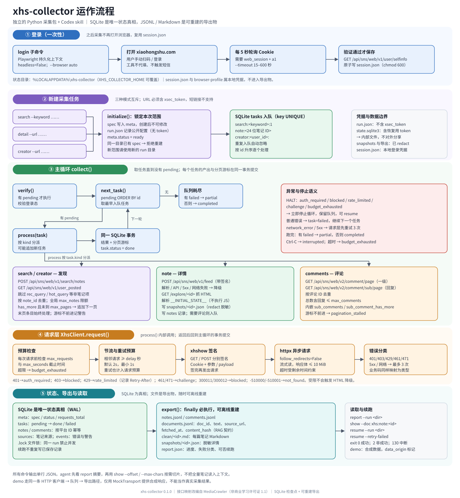

# xhs-collector 运作流程



> 图源：`docs/workflow.svg`。在 VS Code / 浏览器 / GitHub 中直接打开本文件即可查看；图中文字使用系统中文字体，若显示异常请安装 Noto Sans CJK 或使用 Windows / macOS 默认字体。

---

## 0. 一句话概括

**一次性扫码登录 → 把采集范围固化成 SQLite 任务队列 → 在预算内逐个请求平台接口 → 每个任务的结果与游标同事务提交 → 从 SQLite 原子导出 JSONL / Markdown 供 RAG 使用。**

整个项目只有一条主路径：`cli.py` 负责入口，`collector.py` 负责编排，`api.py` 负责访问平台，`storage.py` 负责持久化和导出。任何阶段中断都不会丢已提交的数据，`resume` 从队列断点继续。

---

## 1. 命令入口

所有命令统一输出单行 JSON，退出码含义：`0` 成功、`2` 有类型的失败/部分成功、`130` 被中断、`1` 内部异常。

| 命令 | 作用 | 是否产生 run |
|---|---|---|
| `doctor [--browser-check] [--online]` | 检查依赖、浏览器、可选登录态 | 否 |
| `login [--timeout 180]` | 打开专用浏览器，用户手动扫码 | 否（只写 `session.json`） |
| `search --keyword … --run <dir>` | 按关键词发现并采集 | 是 |
| `detail --url <完整链接> --run <dir>` | 采集指定笔记 | 是 |
| `creator --url <完整链接> --run <dir>` | 采集指定创作者的笔记 | 是 |
| `resume --run <dir> [--retry-failed]` | 续跑未完成任务 | 否（复用已有 run） |
| `report --run <dir>` | 输出进度、失败分类、请求数 | 否 |
| `show --run <dir> --doc <doc_id>` | 按 offset / max-chars 读取文档切片 | 否 |
| `export --run <dir>` | 从 SQLite 离线重建所有导出物 | 否 |
| `download-images --run <dir>` | 为已保存笔记补下图片并重新导出 | 否 |
| `demo --run <dir>` | 用合成数据跑通整条链路 | 是（`data_origin=synthetic_fixture`） |

---

新任务可省略 `--run`，默认生成在 `~/Documents/xhs-collector/runs/`，实际绝对路径在返回 JSON 的 `run` 字段中。默认下载图片，使用 `--no-download-images` 可关闭。登录凭据仍保存在单独的系统状态目录。

图片下载由 `media.py` 处理，以 `image:<note_id>:<序号>` 入队，并与接口共享预算。文件保存在 `clean/images/<note_id>-001.webp`，与 Markdown 同级的 images 文件夹；SQLite 的 `images` 表保存成功文件的信息，任务表保存待处理和失败状态。`markdown.py` 优先引用 images/ 下的本地文件，未下载成功的使用远程链接。

## 2. 五个阶段

### ① 登录（一次性）

1. `login` 在状态目录下启动 Playwright **持久化浏览器上下文**（默认 `headless=False`）。
2. 打开 `www.xiaohongshu.com`，由用户自己扫码；工具不代填、不触发短信、不做账号变更操作。
3. 每 5 秒读取一次 Cookie，必须同时存在 `web_session` 和 `a1`。
4. 立即用 `XhsClient` 请求 `/api/sns/web/v1/user/selfinfo` 验证；成功后原子写入 `session.json`（cookie + UA，`chmod 600`）。
5. 之后所有采集只读 `session.json`，不再打开浏览器。

状态目录默认 `%LOCALAPPDATA%\xhs-collector`（Linux/macOS 为 `~/.local/share/xhs-collector`），可用 `XHS_COLLECTOR_HOME` 覆盖。`session.json`、`browser-profile/` 都属于本地凭据，不会出现在任何导出物里。

### ② 新建任务

`search` / `detail` / `creator` 三选一，由 `cli.py` 解析参数后调用 `collector.initialize()`：

- 把 **spec 写入 meta 表**：模式、关键词、`max_notes`、`max_comments`、`sub_comments`、`max_pages`、`sort`。
- spec **创建后不可修改**；同一 run 目录再次初始化会被拒绝。改变范围请换新目录。
- 写一份公开配置 `run.json`（不含访问 token）。
- 按模式把初始任务写入 `tasks` 表：

| 模式 | 初始任务 key | 后续 |
|---|---|---|
| `search` | `search:<keyword>:1` | 每发现一页追加一条 search 任务 |
| `detail` | `note:<note_id>` | 直接进入详情采集 |
| `creator` | `creator:<user_id>:` | 每翻一页追加一条 creator 任务 |

`detail` / `creator` 的 URL 必须是完整 HTTPS 链接且带 `xsec_token`；短链接和缺 token 的链接会被直接拒绝。

### ③ 主循环

`collector.collect()` 是核心循环，伪代码：

```text
collect():
    spec = meta.spec
    if 存在 pending 任务:
        client.verify()                  # 先确认登录态
    while task := next_task():           # pending 中 id 最小的一条
        try:
            with sqlite_transaction:     # 结果 + 分页游标 + 任务完成
                process(task, spec)
                task.status = "done"
        except CollectError as e:
            记录 event
            若是 HALT 类错误 -> 停止循环，保留队列
            否则 -> task.status = "failed"，继续下一个
    队列耗尽 -> completed（无失败）/ partial（有失败）
```

关键点：

- **同一事务提交**：任务产生的记录、下一页游标、任务状态要么一起成功，要么一起回滚。
- **至少一次请求、按平台 ID 幂等**：中断后可能重新请求未提交的那一页，但笔记 / 评论都按 ID 去重写入。
- **HALT 类错误立即停**：`auth_required`、`blocked`、`rate_limited`、`challenge`、`budget_exhausted` 不会继续重试；其余普通错误只标记该任务失败。

`process()` 按 `task.kind` 分派：

| 任务类型 | 做什么 | 分页 / 去重 |
|---|---|---|
| `search` / `creator` | 调发现接口，把笔记加入 `tasks` | 按 `note_id` 去重；全局 `max_notes` 限额；`has_more` 且未到 `max_pages` 才追加下一页；末页条目始终处理 |
| `note` | `POST /api/sns/web/v1/feed` 取详情；解析 / API / 5xx / 网络失败时降级抓 `GET /explore/<id>` 的 HTML，解析内嵌 `__INITIAL_STATE__` | 写脱敏快照；`INSERT OR REPLACE` 按 ID 幂等；需要评论时入队 |
| `comments` | 一级评论 `/v2/comment/page`，回复 `/v2/comment/sub/page` | 按评论 ID 去重；总数含回复不超过 `max_comments`；处理内嵌回复和“回复还有更多” |
| `image` | 独立图片客户端请求 CDN，检查类型和大小后保存到 `clean/images/` | 按笔记 ID 和序号去重；成功项跳过，失败项可显式重试 |

HTML 降级只针对解析/接口/网络类失败，**访问受限不会触发降级**；解析 `__INITIAL_STATE__` 时不执行页面脚本。

### ④ 请求层

`XhsClient.request()` 是平台接口的统一出口，`process()` 内部调用它。图片客户端单独访问 CDN，不发送账号 Cookie，并通过 `acquire_request()` 共享同一请求预算与间隔：

1. **预算检查**：每次请求前检查 `max_requests` 和 `max_seconds` 截止时间，超限抛 `budget_exhausted`。
2. **节流**：保证相邻请求至少间隔 `delay` 秒（默认 2 秒，最小 1 秒）。
3. **签名**：用 `xhshow` 对 path、Cookie、参数/payload 生成 `sign_headers_get/post`。
4. **发送**：`httpx` 异步流式请求，不跟随重定向，响应体上限 10 MiB，超时受剩余预算约束。
5. **分类**：
   - `401 → auth_required`，`403 → blocked`，`429 → rate_limited`（记录 `Retry-After`），`461/471 → challenge`
   - 业务码 `300011/300012 → blocked`，`-510000/-510001 → not_found`
   - 网络错误 / 5xx 最多重试 3 次，重试也计入请求预算

### ⑤ 状态、导出与读取

**SQLite 是唯一状态真相**，文件只是它的投影：

| 表 | 内容 |
|---|---|
| `meta` | spec、status、请求总数、数据来源 |
| `tasks` | 队列与状态（pending / done / failed），`key` 唯一防重复入队 |
| `notes` / `comments` | 按平台 ID 幂等保存的 JSON 记录 |
| `images` | 已下载图片的相对路径、格式、大小与原链接 |
| `sources` | 每条笔记的来源（关键词 / 创作者 / 指定链接） |
| `events` | 错误、限流、分页停滞、缺 token 等流水 |

`collect()` 的 `finally` 中必执行 `export()`；即使中途失败，导出物也与数据库一致。所有文件用临时文件 + `os.replace` 原子替换。

| 产物 | 用途 |
|---|---|
| `run.json` | 公开任务配置（无 token） |
| `state.sqlite3` | 内部状态，含恢复所需 `xsec_token`，不可外发 |
| `snapshots/<id>.json` | 剔除用户资料与凭据后的详情 JSON |
| `notes.jsonl` | 标题、正文、标签、互动数、图片链接、来源、时间 |
| `comments.jsonl` | 评论文本、笔记关联、父评论关联 |
| `documents.jsonl` | RAG 文档契约：`doc_id / text / source_url / fetched_at / content_hash` |
| `clean/<id>.md` | 每篇笔记的 Markdown |
| `clean/images/<id>-001.webp` | Markdown 相对引用的本地图片；不会由离线 export 重新下载 |
| `report.json` | 当前进度、失败分类、请求次数、是否可续跑 |

读取时先跑 `report` 看摘要，再用 `show --doc xhs:note:<id> --offset … --max-chars …` 取切片；`export` 可以在完全离线时重建全部文件。

---

## 3. 状态与续跑

| 状态 | 含义 | 建议动作 |
|---|---|---|
| `completed` | 配置范围内队列跑完 | 报告采样范围，不代表全平台覆盖 |
| `partial` | 队列跑完但有失败任务 | 看 `failures`；原因解决后 `resume --retry-failed` |
| `auth_required` | 未登录或登录失效 | `login` 后 `resume` 同一目录 |
| `blocked` / `rate_limited` / `challenge` | 平台访问限制 | 停止，按 `Retry-After` 等待；不自动换号/IP |
| `budget_exhausted` | 请求数或时间预算耗尽 | 在用户预算内 `resume` |
| `interrupted` | Ctrl-C | 已提交数据保留，直接 `resume` |
| `internal_error` | 未预期异常 | 先看 event 和任务状态，定位代码后再跑 |
| `run_locked` | 另一进程正在使用该 run | 等它结束 |

---

## 4. 一次 `search` 的完整调用链

```text
python -m xhs_collector search --keyword "露营装备" --max-notes 10
  └─ cli.main()
      └─ cli.execute()
          ├─ run_lock(返回的run目录)                  # 文件锁，防并发
          ├─ Store(create=True)                      # 建表 / 打开 WAL
          ├─ initialize(store, spec)                 # run.json + meta.spec + tasks
          ├─ load_session()                          # 读本地 session.json
          ├─ XhsClient(session, delay, budgets)
          └─ collect(store, client)
              ├─ client.verify()                     # 有 pending 才校验
              ├─ next_task() → process(task)
              │   ├─ client.search(...)              # xhshow 签名 + httpx
              │   ├─ add_note(...)                   # 去重、限额、入队 note 任务
              │   └─ 追加下一页 / 入队 comments
              ├─ 同一事务提交结果与 status=done
              └─ finally: export() → report()
```

---

## 5. 设计不变量

1. **SQLite 是真相**：导出物永远可从 `state.sqlite3` 重建；重复导出不会产生重复记录。
2. **spec 不可变**：一个 run 的范围在创建时锁定，续跑不会悄悄改变口径。
3. **至少一次请求、按 ID 幂等**：崩溃恢复的代价是可能重放一页，而不是丢数据或写重。
4. **受限即停**：遇到限流、风控、验证挑战只记录并保留队列，不自动绕验证。
5. **凭据与数据分离**：`session.json`、`browser-profile/`、`state.sqlite3` 属本地内部文件；快照和导出经过 `redact()`，不含用户资料和 token。
6. **有界采集**：笔记上限 100、每篇评论上限 100、默认每次 100 请求 / 300 秒，面向小样本学习采样。

---

## 6. 明确的边界

- 离线测试与 demo 使用合成数据；真实平台验证单独记录在 `VALIDATION.md`。
- 默认下载图片并保留原链接，可关闭下载；无 OCR、无视频下载/转写。
- 评论是独立文档类型，不能当作笔记作者的事实陈述。
- 去重按平台 ID；`content_hash` 只提供给下游做内容级去重。
- 内容 hash / 文档结构面向 RAG，但本项目不包含向量化和检索。

---

相关文件：`README.md`（使用说明）、`VALIDATION.md`（验证记录）、`skills/xhs-collector/SKILL.md`（agent 操作规则）、`src/xhs_collector/`（实现）。
